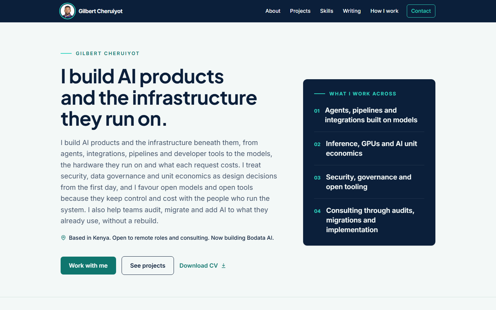
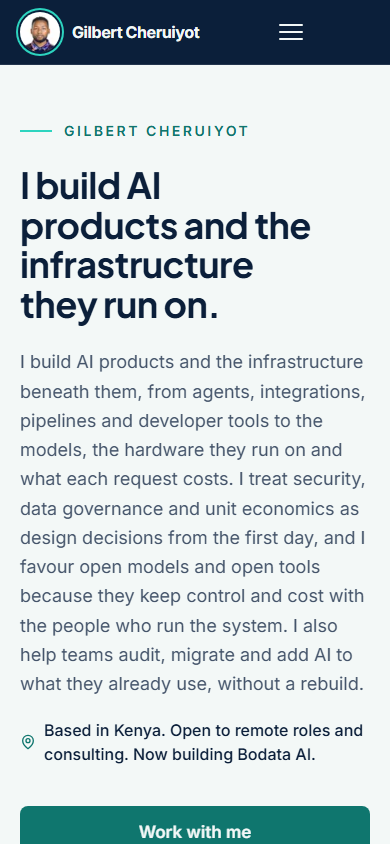

<h1 align="center">gilbert-portfolio</h1>

<p align="center">
  The source of my portfolio site, built with Next.js, TypeScript and Tailwind CSS.
</p>

<p align="center">
  <a href="https://tangus.vercel.app"></a>
  
  
  
  
</p>

<p align="center">
  <a href="https://tangus.vercel.app">
    
  </a>
</p>

## Overview

This site presents my projects, skills, writing and working method, with a contact form and a downloadable CV. All of the copy lives in one typed data file, so content can change without touching the components.

The sections are About, Projects, Skills, Writing, How I work and Contact.

<p align="center">
  
</p>

## Features

- **Content in one place.** Site copy, navigation, social links and the About text come from `src/data/site.ts`, and page metadata is built from the same data.
- **A contact form with no backend.** Messages go to Formspree. A hidden honeypot field catches bots, and the success and error messages receive keyboard focus so screen readers announce them. If sending fails, the message shows a direct email link.
- **Accessible by default.** Links that open a new tab say so for screen readers, form fields have visible labels, and decorative icons are hidden from assistive technology.
- **A downloadable CV** served as a static file.
- **One light theme.** I tried a dark mode toggle and dropped it, so the design stays consistent.

## Tech stack

| Area | Tools |
|---|---|
| Framework | Next.js App Router, React |
| Language | TypeScript |
| Styling | Tailwind CSS |
| Forms | Formspree |
| Hosting | Vercel |
| Quality | ESLint, TypeScript compiler |

## Project structure

```text
src/
  app/          routes, layout and page metadata
  components/   page sections such as Hero, Projects, HowIWork and Contact
  data/site.ts  all site copy, links and settings
  lib/types.ts  shared types
public/
  images/       portrait and static images
  cv/           downloadable CV
docs/
  images/       screenshots used in this README
```

## Getting started

```bash
git clone https://github.com/gilbertofke/gilbert-portfolio.git
cd gilbert-portfolio
npm install
cp .env.example .env.local
npm run dev
```

Open http://localhost:3000. Use a current Node.js LTS release.

## Configuration

| Variable | Purpose |
|---|---|
| `NEXT_PUBLIC_FORMSPREE_ID` | The Formspree form ID the contact form posts to |

Without this variable the form shows "The form is not set up yet" and no message is sent. Next.js reads `NEXT_PUBLIC_` variables at build time, so after changing the value you must rebuild or redeploy. The ID is public by design, because it is part of the form's endpoint URL.

## Scripts

| Command | What it does |
|---|---|
| `npm run dev` | Start the development server |
| `npm run build` | Create a production build |
| `npm run start` | Serve the production build |
| `npm run lint` | Run ESLint |
| `npx tsc --noEmit` | Type check without writing files |

## Editing content

- Change copy, links and the About text in `src/data/site.ts`.
- Replace the portrait at `public/images/portrait.jpg`.
- Replace the CV at `public/cv/Gilbert-Cheruiyot-CV.pdf`.

## Deployment

The site deploys to Vercel from the `main` branch, and every push to `main` triggers a new deployment. Set `NEXT_PUBLIC_FORMSPREE_ID` under Environment Variables for the Production environment, then redeploy.

## Design decisions

- **One data file for content.** Copy changes stay small and reviewable, and no component needs editing for a wording fix.
- **Formspree instead of a custom endpoint.** There is no server to run, secure or pay for, and the form still degrades to a plain email link.
- **Light theme only.** One theme means one design to test and polish.

## Contact

Email gilbertofke@gmail.com, or find me on [LinkedIn](https://www.linkedin.com/in/gilbert-cheruiyot-1a44781a0/) and [GitHub](https://github.com/gilbertofke).

## License

The source is public for reference. The text, images and CV are mine and are not licensed for reuse.
